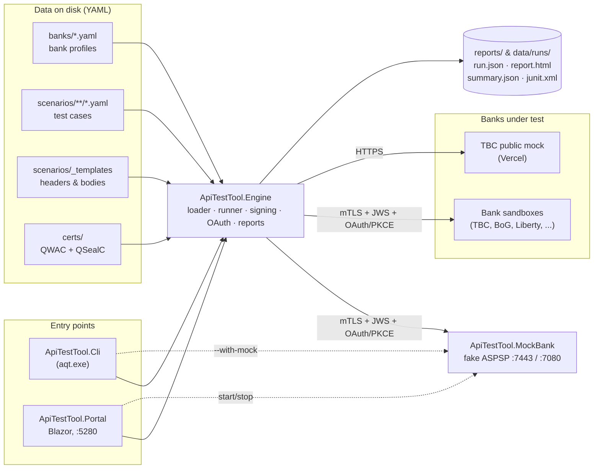
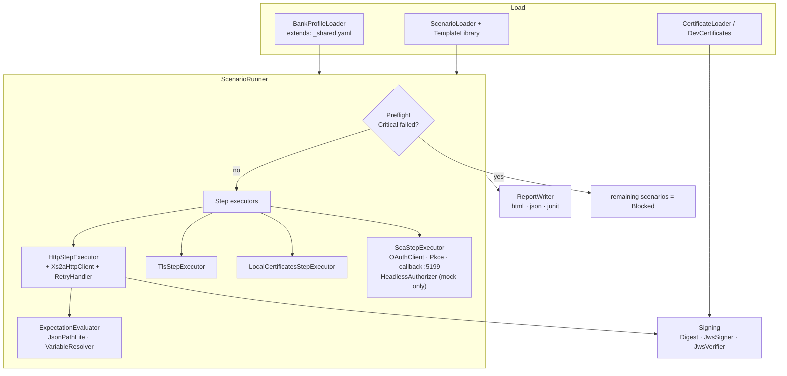
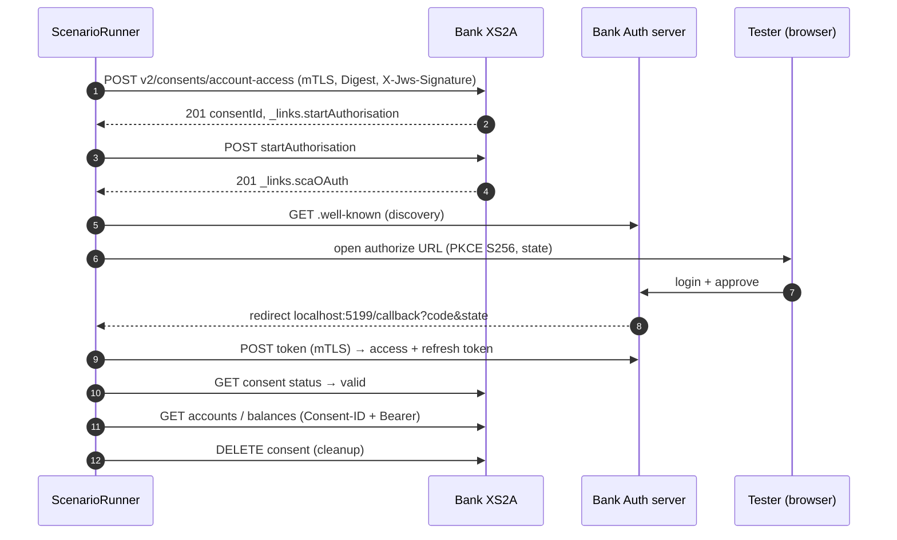

# Architecture

Snapshot of the system as it is **now**. Update this file at the end of every phase (see `docs/ai/PLAN.md`);
the target design lives in the plan. Diagrams are Mermaid (render in GitHub, GitLab, Rider, VS Code).

**Last updated:** 2026-10-24 — before Phase 0 (no AI layer yet).

## 1. Components

## 2. Engine internals

## 3. One AIS scenario at runtime (AIS-001)

## 4. Tech facts

| Item | Value |
|---|---|
| Runtime | .NET 10, C# latest, nullable on |
| Packages | YamlDotNet; xUnit for tests (central versions in `Directory.Packages.props`) |
| Storage | Files only: YAML in, `run.json` + reports out (no database yet) |
| Ports | Portal 5280 · MockBank 7443 (XS2A, mTLS) / 7080 (dashboard) · OAuth callback 5199 |
| Services covered | AIS (consents, accounts, balances, transactions), preflight, negative. No PIS yet |
