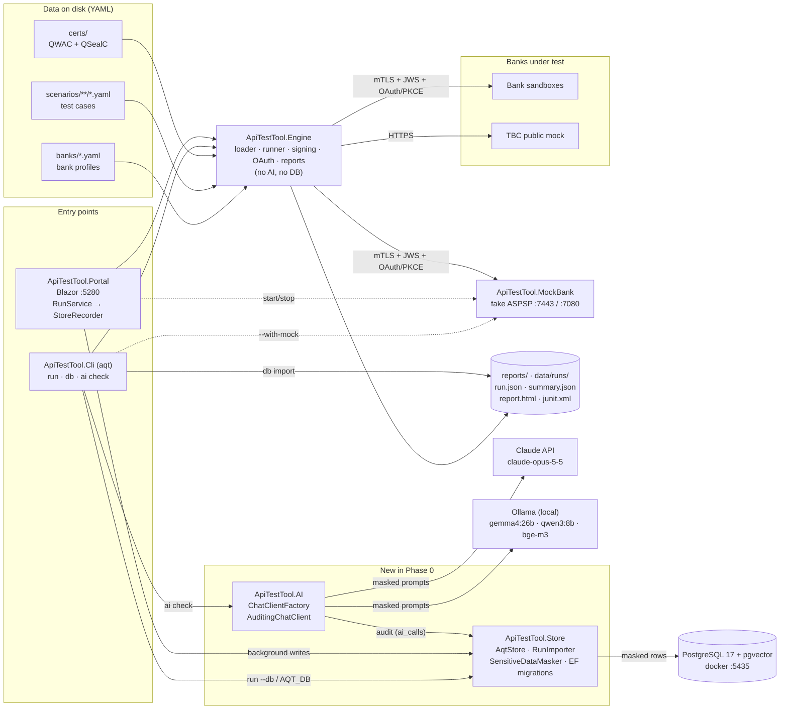
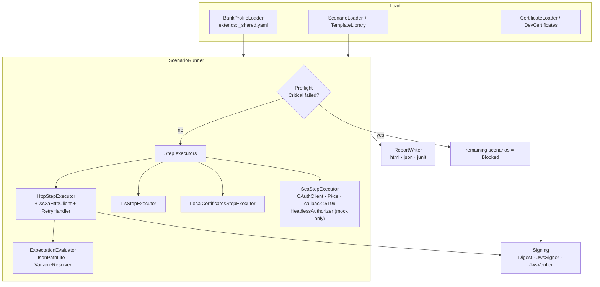
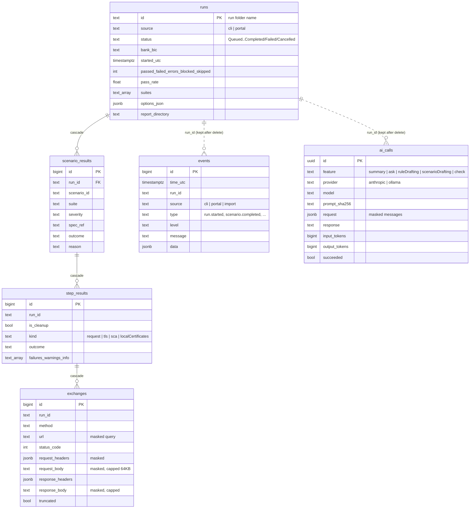
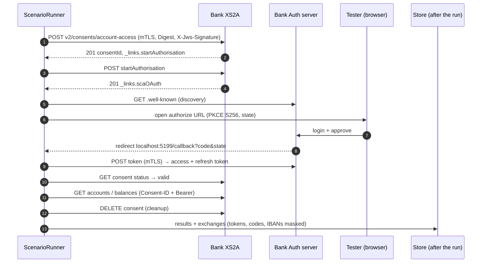

# Architecture

Snapshot of the system as it is **now**. Update this file at the end of every phase (see `docs/ai/PLAN.md`);
the target design lives in the plan. Diagrams are Mermaid (render in GitHub, GitLab, Rider, VS Code).

**Last updated:** 2026-10-24, end of **Phase 0** (store + AI foundations). New in this phase: PostgreSQL store,
masking, run import, AI provider factory with an audit log. No AI features yet.

## 1. Components

Rules the diagram encodes: the engine has no AI and no database dependency; everything that reaches PostgreSQL
or a model passes `SensitiveDataMasker`; a store failure never fails a run (the files on disk are complete and
can be imported later).

## 2. Engine internals (unchanged in Phase 0)

## 3. Store schema

## 4. One AIS scenario at runtime (AIS-001)

## 5. Tech facts

| Item | Value |
|---|---|
| Runtime | .NET 10 (SDK 10.0.402), C# latest, nullable on |
| Packages | YamlDotNet · Npgsql.EntityFrameworkCore.PostgreSQL 10.0.3 + EFCore.NamingConventions · Anthropic 13.3.0 · Microsoft.Extensions.AI 10.11 · OllamaSharp 5.5 · xUnit |
| Storage | YAML in; `run.json` + reports out; PostgreSQL 17 (pgvector image) as the queryable store |
| Ports | Portal 5280 · MockBank 7443 / 7080 · OAuth callback 5199 · PostgreSQL 5435 · Ollama 11434 |
| Tools | `dotnet-ef` 10.0.13 as a local tool (`dotnet tool restore`) |
| Tests | 75: engine 53 · store 17 (3 need `AQT_TEST_DB`) · AI 5 |
| Services covered | AIS (consents, accounts, balances, transactions), preflight, negative. PIS in Phase 5 |
