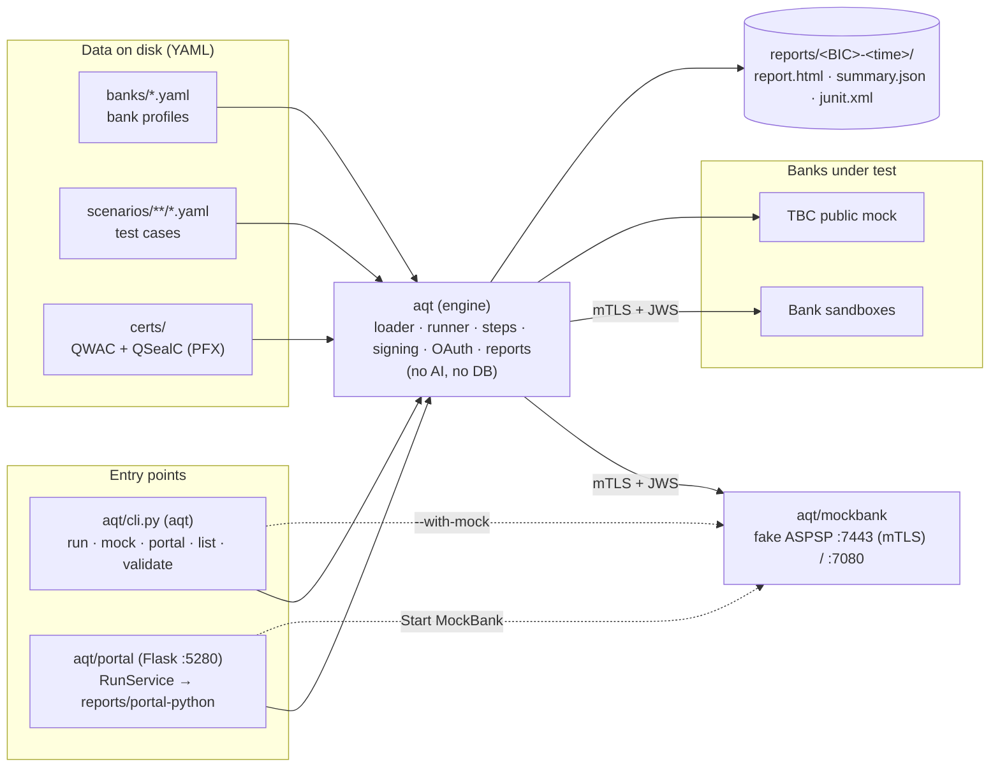
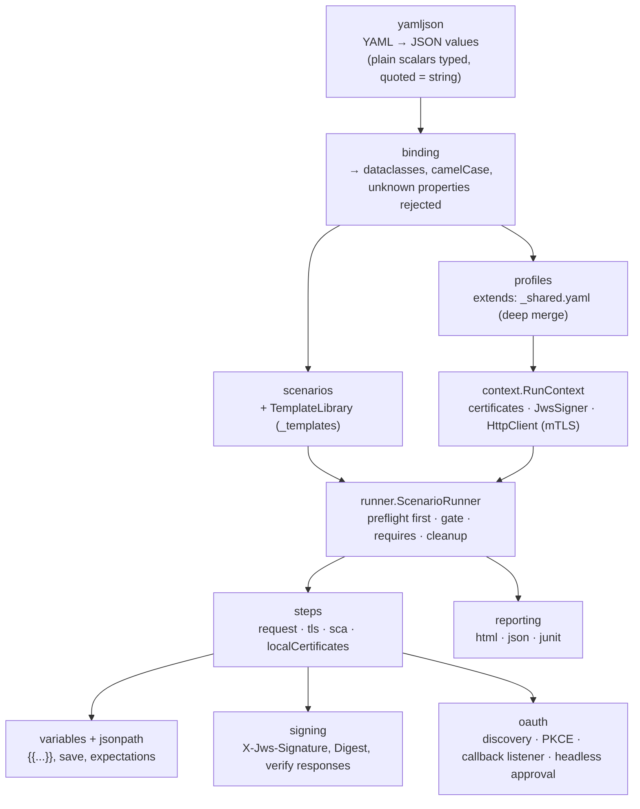
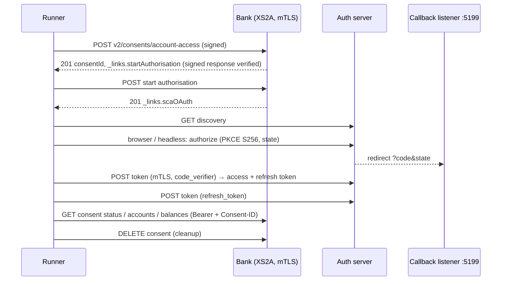

# Architecture

Snapshot of the system as it is **now**. Update this file at the end of every phase (see `docs/ai/PLAN.md`).
Diagrams are Mermaid (render in GitHub, GitLab, Rider, VS Code).

**Last updated:** 2026-10-24, after the move from C# to Python. The engine, CLI, MockBank and portal are Python.
The Store (PostgreSQL), AI (run summaries, rule drafting) and Standards layers of Phases 0–2 existed only in C#
(git history, last C# commit `8abf9f6`) and are not ported yet.

## 1. Components

## 2. Engine internals

| Module | Notes |
|---|---|
| `certificates` | PFX via `cryptography`; self-signed QWAC/QSealC with organizationIdentifier (OID 2.5.4.97); names printed like .NET (`CN=…, O=…, OID.2.5.4.97=…, C=GE`) |
| `signing` | Detached JWS, `b64=false`, `sigD.pars` = x-request-id + PSU/client headers + digest; PS256 (RSA-PSS, salt = hash length) or ES256 (r‖s) |
| `httpclient` | `http.client` + `ssl`: client certificate, no redirects, no decompression, keep-alive per host, optional retries (`limits.retry`) |
| `oauth` | Callback listener on 127.0.0.1 and ::1; headless approval only on pages without a password field |
| `mockbank` | `http.server` threads; HTTPS via pyOpenSSL so any client certificate is accepted and checked by the XS2A middleware |

## 3. One AIS scenario at runtime (AIS-001)

## 4. Tech facts

- Python 3.11+; PyYAML, cryptography, pyOpenSSL, Flask; pytest.
- Ports: portal 5280, MockBank 7443 (HTTPS, mTLS) and 7080 (HTTP pages), OAuth callback 5199.
- Reports keep the C# `summary.json` shape (camelCase, nulls omitted); interop with the C# client and MockBank was
  verified in both directions before the C# code was removed.
