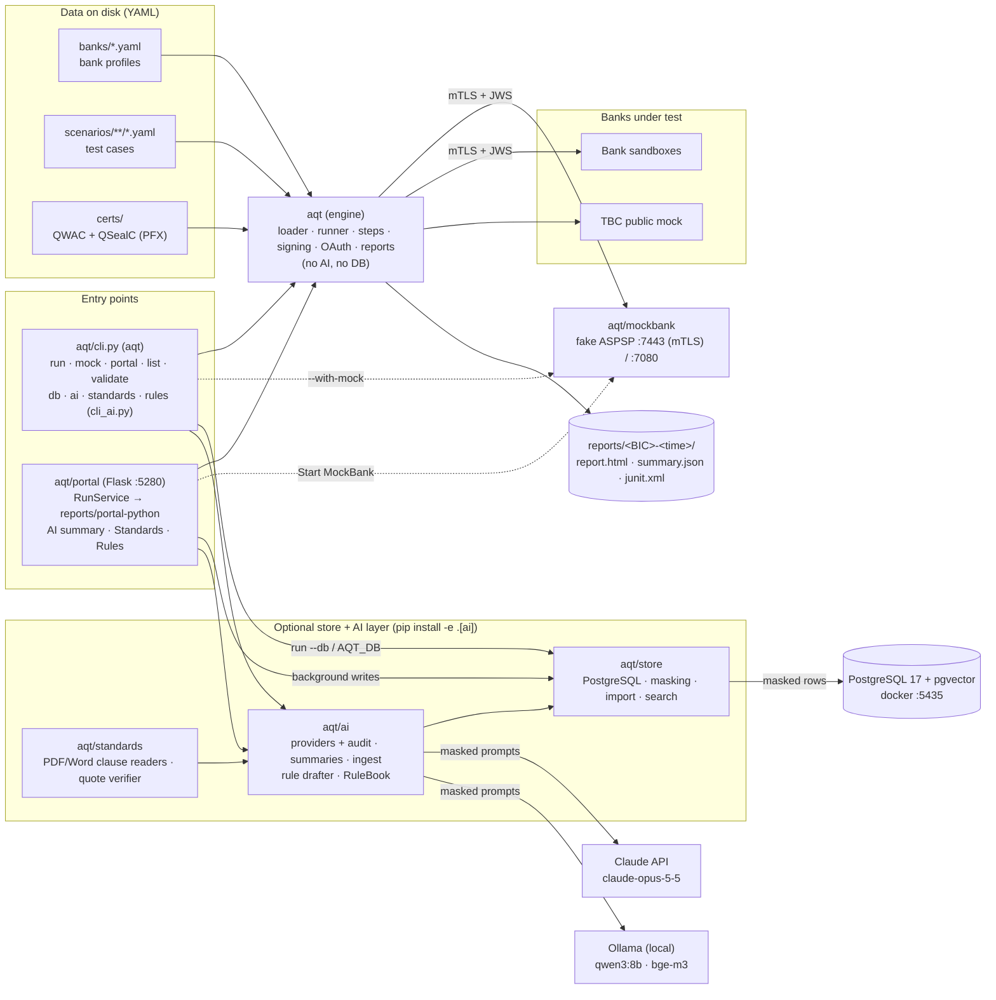
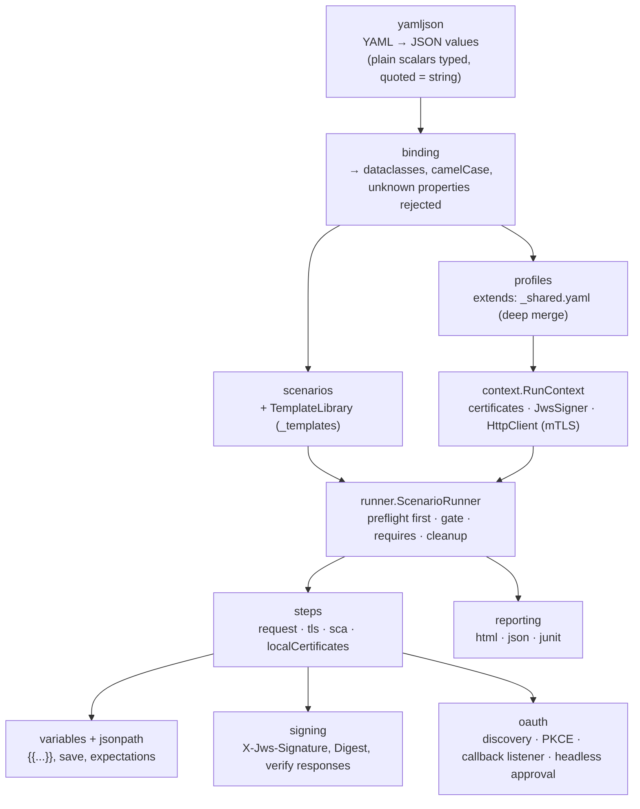
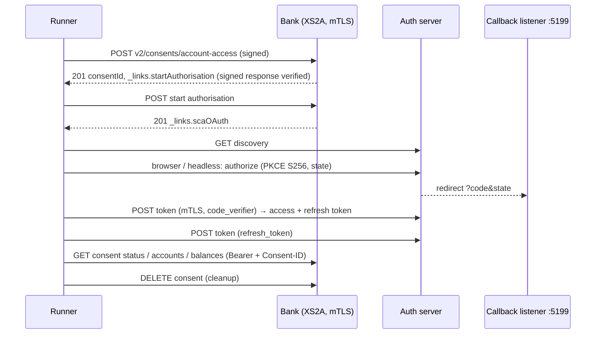
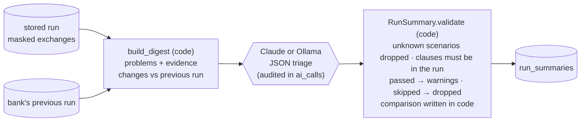
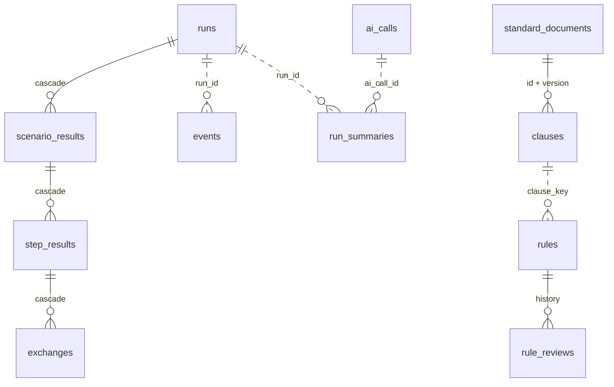

# Architecture

Snapshot of the system as it is **now**. Update this file at the end of every phase (see `docs/ai/PLAN.md`).
Diagrams are Mermaid (render in GitHub, GitLab, Rider, VS Code).

**Last updated:** 2026-10-24, after porting the Store, Standards and AI layers (Phases 0–2) to Python. Everything is
Python now: engine, CLI, MockBank, portal, and the optional store/AI layer (`aqt/store`, `aqt/standards`, `aqt/ai`,
`aqt/cli_ai.py`, `aqt/portal/ai_services.py`). The C# implementation is in git history (last C# commit `8abf9f6`).

## 1. Components

The engine has no AI and no database dependency. Everything that reaches PostgreSQL or a model passes
`aqt/store/masking.py` first; a store failure never fails a run (the files on disk are complete and can be imported).

## 2. Engine internals

| Module | Notes |
|---|---|
| `certificates` | PFX via `cryptography`; self-signed QWAC/QSealC with organizationIdentifier (OID 2.5.4.97); names printed like .NET (`CN=…, O=…, OID.2.5.4.97=…, C=GE`) |
| `signing` | Detached JWS, `b64=false`, `sigD.pars` = x-request-id + PSU/client headers + digest; PS256 (RSA-PSS, salt = hash length) or ES256 (r‖s) |
| `httpclient` | `http.client` + `ssl`: client certificate, no redirects, no decompression, keep-alive per host, optional retries (`limits.retry`) |
| `oauth` | Callback listener on 127.0.0.1 and ::1; headless approval only on pages without a password field |
| `mockbank` | `http.server` threads; HTTPS via pyOpenSSL so any client certificate is accepted and checked by the XS2A middleware |

## 3. One AIS scenario at runtime (AIS-001)

## 4. AI run summary

## 5. Standards → rules → human review

```mermaid
flowchart LR
    Src[("standards/sources.yaml<br/>URL + SHA-256")] -->|fetch + verify| Files[("PDF / .docx")]
    Files --> Read["readers (code)<br/>PDF: TOC → headings<br/>Word: heading styles"]
    Read --> Clauses[("clauses<br/>tsvector + vector(1024)")]
    Clauses --> Draft{{"RuleDrafter<br/>Claude or local model"}}
    Draft --> Check["checks (code)<br/>quote in clause → else invalid<br/>level vs wording · duplicates"]
    Check --> Queue[("rules: draft / invalid")]
    Queue --> Review["person (portal / CLI)<br/>approve · edit · reject · reopen"]
    Review --> Approved[("rules: approved<br/>rule_reviews history")]
    Approved -->|aqt rules export| Yaml[("rules/*.yaml")]
```

## 6. Store schema

Migrations are SQL files in `aqt/store/migrations/`, tracked in `aqt_schema_migrations`. `0001` is the schema the C#
tool created; a database created by the C# tool is recognised (its EF Core history) and kept as it is.

## 7. Tech facts

- Python 3.11+; PyYAML, cryptography, pyOpenSSL, Flask; pytest. Optional `ai` extra: psycopg 3 + pgvector, anthropic,
  pdfplumber (Ollama is called over HTTP).
- Ports: portal 5280, MockBank 7443 (HTTPS, mTLS) and 7080 (HTTP pages), OAuth callback 5199, PostgreSQL 5435,
  Ollama 11434.
- Tests: 93 with `AQT_TEST_DB` (22 engine/portal, 71 store/standards/AI/portal-AI); without a database 76 pass and the
  17 database tests are skipped.
- Reports keep the C# `summary.json` shape (camelCase, nulls omitted); interop with the C# client and MockBank was
  verified in both directions before the C# code was removed.
