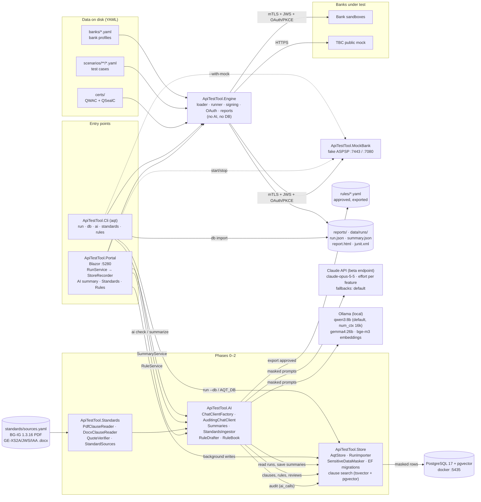
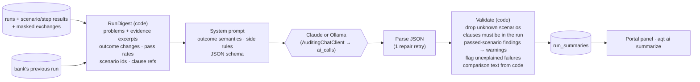
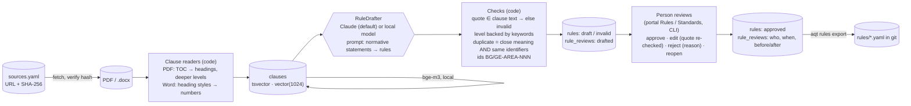
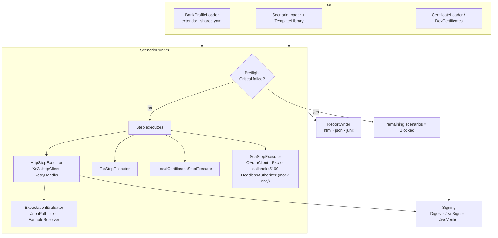
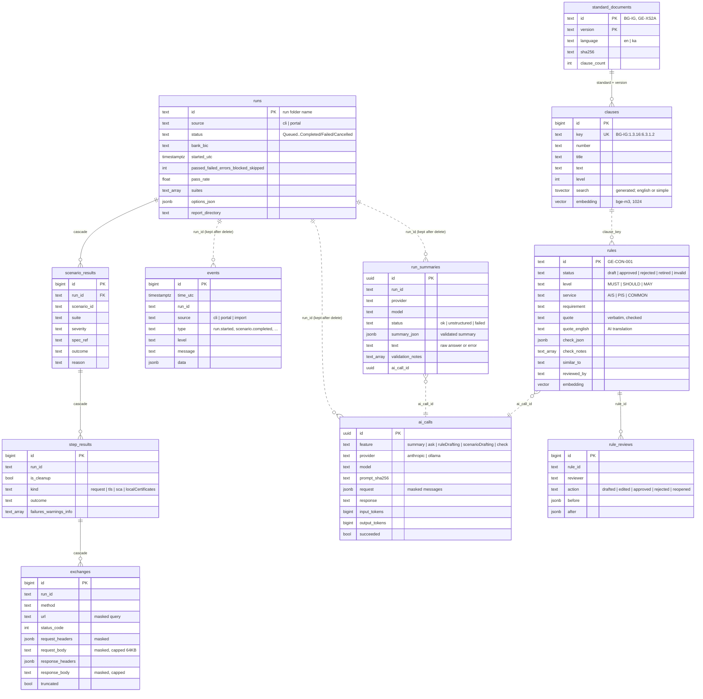
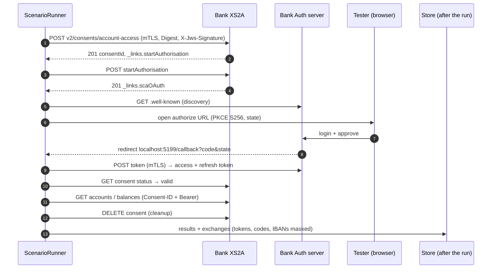

# Architecture

Snapshot of the system as it is **now**. Update this file at the end of every phase (see `docs/ai/PLAN.md`);
the target design lives in the plan. Diagrams are Mermaid (render in GitHub, GitLab, Rider, VS Code).

**Last updated:** 2026-10-24, end of **Phase 2** (standards → AI-drafted rules → human review).
Phase 0: PostgreSQL store, masking, run import, AI provider factory with an audit log. Phase 1: AI run summaries.
Phase 2: `ApiTestTool.Standards` (clause readers, quote verifier, sources manifest), clauses with full-text and vector
search, rule drafting with checks in code, the review workflow (`RuleBook`) and the portal's Standards and Rules pages.

## 1. Components

Rules the diagram encodes: the engine has no AI and no database dependency; everything that reaches PostgreSQL
or a model passes `SensitiveDataMasker`; a store failure never fails a run (the files on disk are complete and
can be imported later).

## 2. AI run summary (Phase 1)

The model decides grouping, side (bank / our side / environment / unclear), explanation and next step. Everything
that can be checked or computed — counts, run-to-run changes, scenario ids, clause references — is done in code.

## 3. Standards → rules (Phase 2)

## 4. Engine internals (unchanged since Phase 0)

## 5. Store schema

## 6. One AIS scenario at runtime (AIS-001)

## 7. Tech facts

| Item | Value |
|---|---|
| Runtime | .NET 10 (SDK 10.0.402), C# latest, nullable on |
| Packages | YamlDotNet · Npgsql.EntityFrameworkCore.PostgreSQL 10.0.3 + EFCore.NamingConventions · Pgvector.EntityFrameworkCore 0.3 · PdfPig 0.1.16 · Anthropic 13.3.0 · Microsoft.Extensions.AI 10.11 · OllamaSharp 5.5 · xUnit |
| Storage | YAML in; `run.json` + reports out; PostgreSQL 17 (pgvector image) as the queryable store |
| Ports | Portal 5280 · MockBank 7443 / 7080 · OAuth callback 5199 · PostgreSQL 5435 · Ollama 11434 |
| Tools | `dotnet-ef` 10.0.13 as a local tool (`dotnet tool restore`) |
| Tests | 122: engine 53 · standards 17 · store 19 (4 need `AQT_TEST_DB`) · AI 33 (8 need `AQT_TEST_DB`) |
| Standards in the store | BG-IG 1.3.16 (182 clauses) · GE-XS2A 0.8.RC3 (133) · GE-JWS 0.5.RC1 (32) · GE-IAA 0.8.RC1 (32), all embedded |
| Services covered | AIS (consents, accounts, balances, transactions), preflight, negative. PIS in Phase 5 |
